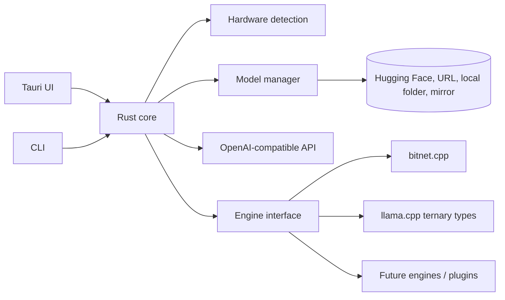

<div align="center">

# 🔺 Tern

**A free, open-source, offline-first app for running ternary (1.58-bit) LLMs on your own machine.**
Easy to use. Full control. No accounts, no telemetry, no vendor lock-in.


[Quick start](#-quick-start) · [Features](#-features) · [Requirements](#-requirements) · [Architecture](#-architecture) · [Roadmap](#-roadmap) · [Contributing](#-contributing)

</div>

> **Note:** Tern is in pre-alpha. This README describes the project's goals and design. Items marked ✅ exist, items marked 🚧 are in progress, and items marked 🗓️ are planned. Rename the project and update the badges and links before publishing.

---

## 🤔 Why Tern?

Ternary models (such as BitNet b1.58) store each weight as `-1`, `0`, or `+1`. Matrix multiplication turns into additions and lookups, which means **less memory, less energy, and faster CPU inference** than conventional quantization, but only for models *trained* as ternary.

Existing local-LLM apps are built around general-purpose GGUF models. Tern is built around ternary from the start:

| | Typical local LLM app | **Tern** |
|---|---|---|
| Primary focus | Many model formats | Ternary-first, efficient on CPUs |
| Energy / speed readout | Rarely shown | Live tokens/sec, RAM, and watts (where the OS allows) |
| Engine | One fixed backend | Swappable engines behind a common interface |
| Accounts / cloud | Sometimes | **Never required** |
| Governance | Often single-company | Community-governed, DCO, no CLA |

---

## ✨ Features

- ✅ / 🚧 / 🗓️ markers show the current state.

- 🗓️ **One-click setup:** detects your CPU, recommends a model that fits your RAM, downloads it, and starts chatting.
- 🗓️ **Ternary-first engine support:** `bitnet.cpp` (I2_S, TL1, TL2 kernels) with a pluggable interface for others (e.g. llama.cpp ternary types).
- 🗓️ **Full control:** sampling parameters, context size, system prompt, threads, CPU pinning, kernel selection.
- 🗓️ **Power dial:** cap threads or target a tokens/sec budget to trade speed for energy.
- 🗓️ **Built-in benchmarking:** tokens/sec and tokens-per-joule versus a llama.cpp baseline on *your* hardware.
- 🗓️ **OpenAI-compatible local API:** `http://localhost:<port>/v1/chat/completions` works with existing tools.
- 🗓️ **Open model sources:** Hugging Face, local folders, direct URLs, or your own mirror. No hard-coded registry.
- 🗓️ **Plugin interface:** add engines, tools, or UI panels without forking.
- 🗓️ **Privacy:** fully offline after the model download; no telemetry by default.

<details>
<summary><b>🔍 What "full control" means in practice (click to expand)</b></summary>

<br>

| Setting | What you can change |
|---|---|
| Sampling | temperature, top-p, top-k, min-p, repeat penalty, seed |
| Context | context length, batch size |
| Compute | thread count, CPU affinity, kernel (I2_S / TL1 / TL2) |
| Power | thread cap, tokens/sec target |
| Server | port, bind address, API key (optional), CORS |
| Data | where models and chats are stored; everything is plain files |

</details>

---

## 🚀 Quick start

> 🗓️ Installers are not published yet. Until the first release, build from source (see [Development setup](#-development-setup)).

**Once released:**

1. Download the installer for your OS from the [Releases](../../releases) page.
2. Open Tern. It detects your hardware and suggests a model.
3. Click **Download**, then **Chat**.

**Use it from other tools:**

```bash
curl http://localhost:8080/v1/chat/completions \
  -H "Content-Type: application/json" \
  -d '{
    "model": "bitnet-b1.58-2b-4t",
    "messages": [{"role": "user", "content": "Hello!"}]
  }'
```

---

## 📋 Requirements

Pick the tab that matches you. Click to expand.

<details open>
<summary><b>👤 For users (running Tern)</b></summary>

<br>

| Requirement | Minimum | Recommended |
|---|---|---|
| OS | Windows 10/11 (64-bit), macOS 12+, or a recent Linux (x86_64 or ARM64) | Same |
| CPU | 64-bit with AVX2 (x86) or NEON (ARM) | Modern 6+ core CPU |
| RAM | 4 GB free (for ~2B ternary models) | 8 GB+ |
| Disk | ~2 GB per model, plus app size | SSD with 10 GB free |
| GPU | Not required | Not used in early versions |
| Internet | Only to download models | n/a |

> Ternary models are small. A ~2B-parameter ternary model needs far less memory than the same-size FP16 model, but the exact figure depends on the model and context length.

</details>

<details>
<summary><b>🛠️ For developers (building Tern)</b></summary>

<br>

**All platforms**

- [ ] Git (with submodule support)
- [ ] Rust (stable toolchain, via [rustup](https://rustup.rs))
- [ ] Node.js (current LTS) and a package manager (npm or pnpm)
- [ ] Tauri CLI (`cargo install tauri-cli`)
- [ ] CMake 3.22 or newer
- [ ] Clang 18 or newer (required to build `bitnet.cpp`)
- [ ] Python 3.9 (used by the `bitnet.cpp` setup scripts; conda is recommended)
- [ ] Hugging Face CLI (`pip install huggingface_hub`) for downloading models

**Windows**

- [ ] Visual Studio 2022 with *Desktop development with C++*, *C++ CMake tools*, *Git for Windows*, and *C++ Clang tools*
- [ ] WebView2 runtime (preinstalled on Windows 11)
- [ ] Run builds from the *Developer Command Prompt for VS 2022*

**macOS**

- [ ] Xcode Command Line Tools (`xcode-select --install`)

**Linux (Debian/Ubuntu example)**

- [ ] `build-essential`, `libwebkit2gtk-4.1-dev`, `libssl-dev`, `libayatana-appindicator3-dev`, `librsvg2-dev`
- [ ] Equivalent packages on other distros (see the Tauri docs for your distro)

> Check the upstream [BitNet](https://github.com/microsoft/BitNet) and [Tauri](https://tauri.app) docs for the latest version requirements before you start. They change over time.

</details>

<details>
<summary><b>🤝 For maintainers (running the project)</b></summary>

<br>

- [ ] A GitHub **organization** (not a personal account) so the project can outlive any one person
- [ ] `LICENSE` (Apache-2.0 or MIT)
- [ ] `CONTRIBUTING.md` using a **DCO** sign-off (`git commit -s`), with no CLA
- [ ] `GOVERNANCE.md` (how maintainers are added and decisions are made)
- [ ] `CODE_OF_CONDUCT.md` and `SECURITY.md`
- [ ] GitHub Actions for build and release on Windows, macOS, and Linux
- [ ] Code signing certificates (macOS notarization, Windows signing) for trusted installers
- [ ] A third-party license notice file (llama.cpp and BitNet are MIT; check every model's own license)

</details>

---

## 🧰 Development setup

> Commands below are the planned workflow; adjust paths as the repo takes shape.

```bash
# 1. Clone with submodules (the engine lives in a submodule)
git clone --recursive https://github.com/<your-org>/tern.git
cd tern

# 2. Build the ternary engine (bitnet.cpp)
cd engines/bitnet
conda create -n bitnet-cpp python=3.9
conda activate bitnet-cpp
pip install -r requirements.txt

# 3. Download a ternary model and prepare it
huggingface-cli download microsoft/BitNet-b1.58-2B-4T-gguf \
  --local-dir models/BitNet-b1.58-2B-4T
python setup_env.py -md models/BitNet-b1.58-2B-4T -q i2_s
cd ../..

# 4. Run the app in dev mode
npm install
cargo tauri dev
```

<details>
<summary><b>🧪 Running tests and benchmarks</b></summary>

<br>

```bash
cargo test                 # Rust core tests
npm test                   # UI tests
cargo run --bin tern-bench # tokens/sec and energy comparison vs. a llama.cpp baseline
```

</details>

---

## 🏗️ Architecture



**Key principle:** the UI never talks to an engine directly. Everything goes through the engine interface, so no single upstream project controls Tern.

<details>
<summary><b>📁 Planned repository layout</b></summary>

<br>

```
tern/
├── app/                 # Tauri + frontend (UI)
├── core/                # Rust core: process manager, hardware detection, model manager
├── engines/
│   ├── bitnet/          # bitnet.cpp (submodule)
│   └── llamacpp/        # llama.cpp adapter
├── api/                 # OpenAI-compatible server layer
├── plugins/             # Example plugins
├── bench/               # Benchmark harness (tokens/sec, tokens/joule)
├── docs/
├── .github/workflows/   # CI: build matrix and releases
├── LICENSE
├── CONTRIBUTING.md
├── GOVERNANCE.md
└── README.md
```

</details>

---

## ⚠️ Known limitations

- **Only natively trained ternary models get the efficiency gains.** Converting a normal model to ternary without retraining hurts quality, so Tern's model list is deliberately small for now.
- Early versions are CPU-focused; GPU support is not a goal for the first releases.
- Power readouts depend on what your OS and hardware expose, so they may be estimates on some systems.

---

## 🗺️ Roadmap

### v0.x: Pre-alpha (now)
- [x] Project scaffold, licensing, governance, CI
- [ ] Ternary weight format spec (`spec/`)
- [ ] Scalar reference implementation that loads a model and generates text

### v1.0: CPU engine
- [ ] Packed-weight CPU kernels (AVX2, AVX-512, ARM NEON)
- [ ] Paged KV cache and continuous batching
- [ ] OpenAI-compatible server (`/v1/chat/completions`)
- [ ] Benchmarks versus llama.cpp on identical hardware

### v2.0: Beta: Anthropic API and CUDA
- [ ] Anthropic Messages API compatibility (`/v1/messages`)
- [ ] Streaming in Anthropic's event format
- [ ] CUDA backend (int8 and ternary kernels)
- [ ] Quantized KV cache (int8)
- [ ] Multi-GPU tensor parallelism

---

## 🤝 Contributing

Contributions of every size are welcome: code, docs, benchmarks on your hardware, bug reports, and translations.

1. Fork the repo and create a branch.
2. Make your change and add tests where it makes sense.
3. Sign off your commits: `git commit -s -m "your message"`.
4. Open a pull request.

Read [CONTRIBUTING.md](CONTRIBUTING.md) and [GOVERNANCE.md](GOVERNANCE.md) first. Look for issues labeled `good first issue`.

---

## ❓ FAQ

<details>
<summary><b>Is it really free and private?</b></summary>

Yes. It is open source, needs no account, and sends no telemetry by default. After you download a model, it works fully offline.

</details>

<details>
<summary><b>Can I run Llama, Qwen, or other normal models?</b></summary>

Not with the ternary speedups. Those require models trained as ternary. A fallback to standard llama.cpp for regular GGUF files is on the roadmap.

</details>

<details>
<summary><b>How is this different from Jan or LM Studio?</b></summary>

Tern is ternary-first, shows efficiency numbers, is built around swappable engines, and is community-governed with no CLA.

</details>

<details>
<summary><b>Can I add my own engine or model source?</b></summary>

Yes. That is what the engine interface and plugin system are for.

</details>

---

## 📜 License

Tern is licensed under the [Apache-2.0 License](LICENSE). Third-party components keep their own licenses; see [THIRD_PARTY_NOTICES.md](THIRD_PARTY_NOTICES.md). Models you download are governed by their own licenses.

## 🙏 Acknowledgements

- [microsoft/BitNet](https://github.com/microsoft/BitNet) (`bitnet.cpp`) for the ternary inference engine
- [llama.cpp](https://github.com/ggml-org/llama.cpp) and the GGUF ecosystem
- [Tauri](https://tauri.app) for the app framework
- Everyone working on efficient, open, local AI
